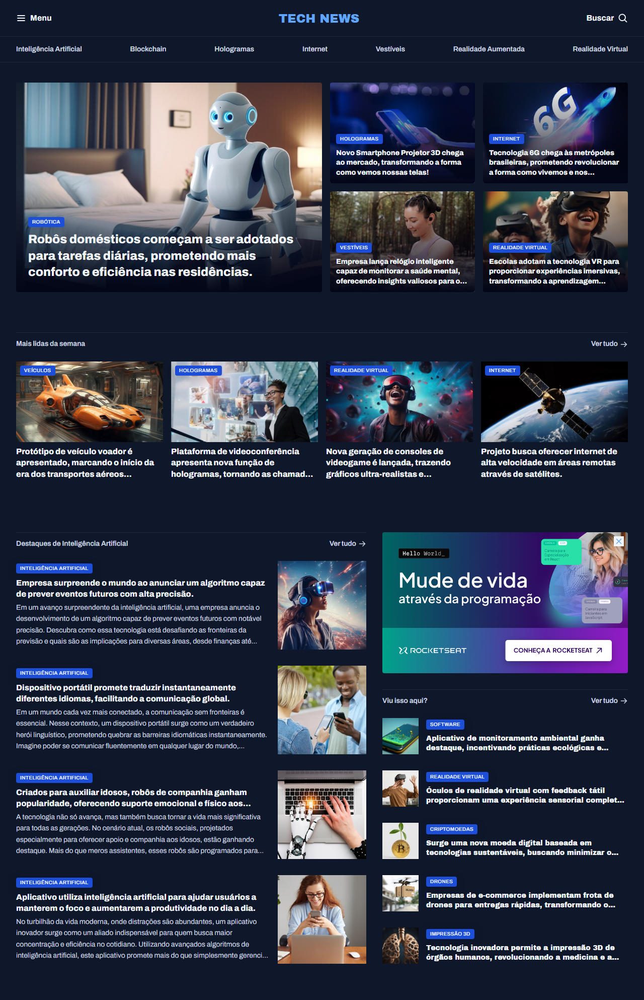

# Portal de Notícias — Tech News

Portal de notícias de tecnologia desenvolvido com HTML e CSS puros a partir de um layout do Figma, como desafio da formação Full-Stack da Rocketseat.

🎨 **[Ver o layout no Figma](https://www.figma.com/design/TalEQ8GGKrJAHYeNOzOB62/Portal-de-not%C3%ADcias--Community-)**



## Sobre o projeto

A página reúne notícias sobre inteligência artificial, robótica, realidade virtual, internet e outros temas de tecnologia, organizadas em quatro áreas:

- **Destaques**: uma notícia principal e quatro secundárias, com imagem de fundo e degradê
- **Mais lidas da semana**: quatro notícias em colunas
- **Destaques de Inteligência Artificial**: notícias com título, resumo e imagem ao lado
- **Barra lateral**: anúncio que pode ser fechado e a lista "Viu isso aqui?"

## Tecnologias

- HTML5 semântico (`header`, `nav`, `main`, `section`, `article`, `aside`)
- CSS3 com variáveis customizadas (`:root`), Grid, Flexbox e media queries
- Google Fonts: Archivo e Archivo Black
- Ícones do Phosphor Icons e imagens do Freepik, exportados do Figma
- Um pequeno script em JavaScript para fechar o anúncio

## Estrutura

```
Projeto Pagina de Noticias/
├── index.html
├── styles/
│   ├── global.css      # variáveis do Style Guide, reset e utilitários
│   └── index.css       # componentes, seções e responsividade
└── images/
    ├── ads.png
    ├── preview.png
    ├── icons/          # list, magnifying-glass, arrow-right, x
    └── news/           # noticia-01.png … noticia-18.png
```

## Como rodar localmente

Abra o `index.html` no navegador. Não há dependências nem build.

Se preferir, use a extensão **Live Server** do VS Code: clique com o botão direito no `index.html` e escolha **Open with Live Server**.

## Style Guide

| Variável | Cor | Uso |
|---|---|---|
| `--brand-color-light` | `#60A5FA` | Logo e estado hover dos links |
| `--brand-color-dark` | `#1D4ED8` | Fundo das tags de categoria |
| `--bg-color` | `#0F172A` | Fundo da página |
| `--stroke-color` | `#1E293B` | Bordas e divisórias |
| `--text-color-primary` | `#F1F5F9` | Títulos e textos principais |
| `--text-color-secondary` | `#CBD5E1` | Resumos, links e títulos de seção |

| Estilo | Tamanho | Altura de linha | Peso |
|---|---|---|---|
| heading1 | 24px | 135% | ExtraBold |
| heading2 | 16px | 140% | ExtraBold |
| heading3 | 14px | 140% | ExtraBold |
| span | 14px | 145% | SemiBold |
| paragraph | 14px | 160% | Regular |

## O que foi praticado

- Tradução fiel de um layout do Figma para código, usando os tokens do Style Guide como variáveis CSS
- Estruturação semântica e hierarquia correta de títulos (h1 → h2 → h3)
- CSS Grid para os destaques e colunas, Flexbox para os cards
- Card inteiro clicável com a técnica de link "esticado" (`::after`)
- Limite de linhas com reticências usando `line-clamp`
- Estado hover dos links conforme o componente Link Button do Figma
- Acessibilidade: textos alternativos, link "Pular para o conteúdo", foco visível no teclado, `aria-label` nos botões de ícone e respeito ao `prefers-reduced-motion`
- Performance: `width`/`height` nas imagens e `loading="lazy"` abaixo da primeira dobra
- Layout responsivo com breakpoints em 1024px e 640px

## Autor

**Guilherme Henrique Canducci**
[LinkedIn](https://www.linkedin.com/in/guilherme-henrique-canducci-b84676304) · [GitHub](https://github.com/gHcanducci)
